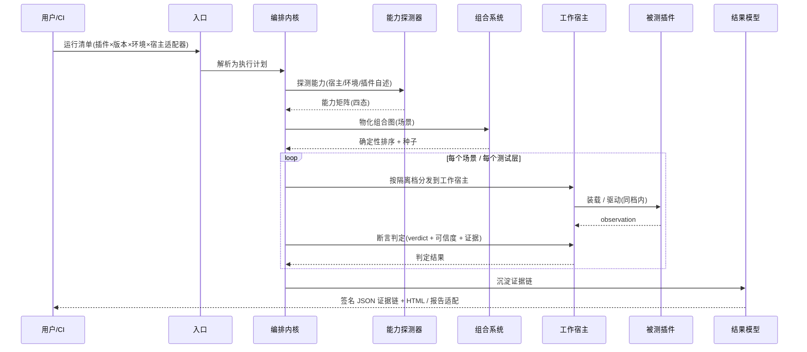
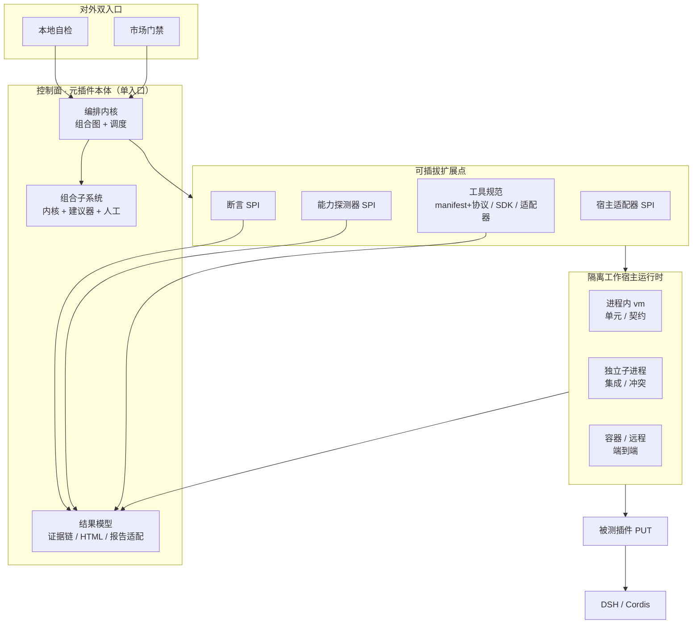
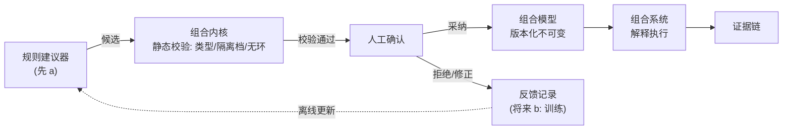

# DSH 插件测试平台 — 架构文档

- 状态：设计定稿（待评审）
- 日期：2026-10-14
- 范围：一个安装进 DSH（DeepSeek Harness）的「元插件」，用来验证其它 DSH 插件
- 理论证明：[theory-proof.md](theory-proof.md)（对本设计关键机制的形式化论证、显式假设与边界）
- 交互图：[architecture.html](architecture.html) · 人读渲染：[architecture.doc.html](architecture.doc.html)

---

## 1. 一句话定位

一个装进 DSH 里的 **元插件**，用 DSH 自己的机制去验证其它 DSH 插件——从无宿主的单元逻辑，到契约、集成、多插件冲突、端到端；从开发者本地自检，到插件市场的统一质量门禁；全程由「可信内核 + 可插拔适配器」这一架构风格贯穿。

---

## 2. 背景与动机

DSH 的插件生态需要一个**统一的验证层**。当前痛点：

- 插件作者缺少一条从「纯函数能跑」到「在真实宿主里能和别人共存」的完整测试链；
- 插件市场的准入缺少**可复现、可审计、不可篡改**的质量证据；
- 没有统一的「契约真源」，插件对 DSH API 的用法只能靠人肉 review。

本平台把这些需求收敛成一套分层、可组合、可扩展的测试能力，并用「确定性优先」保证同一个规格在任何地方跑出同一结论。

---

## 3. 质量属性（目标层）

这是平台要达成的**目标**，不是实现细节：

| 属性 | 含义 |
|---|---|
| **准确性** | 测试结果可复现、可验证、不可篡改 |
| **通用性** | 支持多宿主、多版本、多插件、多环境 |
| **可组合** | 基础工具 → 小场景 → 大场景，层层组合 |
| **可扩展** | 宿主适配器、断言、能力探测器均可插拔 |

---

## 4. 设计原则（约束层）

四条目标靠下面十条**纪律**落地：

| 原则 | 落地含义 |
|---|---|
| 判定精确 | 结果用显式 `verdict` 枚举（pass / fail / skip / error / inconclusive），无隐式「通过」 |
| 可信度显式 | 每个判定绑定证据来源 + 可信级（静态源码 / mock 契约 / 真实宿主 / 重放快照） |
| 规格先行 | 契约与场景先建模成可执行规格，断言与报告由规格生成，不从结果反推 |
| 对象安全 | 平台与测试对象零共享可变状态，只走序列化快照/消息；自制代码按不受信第三方对待 |
| 线程安全 | 异步 / worker / 并发运行安全，并发用例不污染共享状态 |
| 分层职责 | 五层各断言各的对象，不越层（契约层不碰真实宿主内部，集成层不重复单测语义） |
| 确定性优先 | 钉死环境快照/版本矩阵/随机种子/执行顺序/调度；非确定项显式标注 |
| 完整性可验证 | 报告带「应跑清单 / 已跑清单 / 覆盖缺口」，证明无静默跳过 |
| 组合可验证 | 组合规则可静态校验；组合判定是成分判定的确定性函数 |
| 最小信任 | 不信任插件自述与宿主行为，只信外部可观察证据（能力要实测，不轻信声明） |

### 架构风格：可信内核 + 可插拔适配器

几乎每个子系统都是这个形：**内核守确定性/可验证，适配器守通用性/可扩展**。宿主适配器、断言、能力探测器、建议器、报告适配器、工具 SDK/协议，全部复用同一模式。

### 拆分纪律

模块按 **职责边界 + 受信等级 + 变更频率** 切，不按文件大小切；依赖只指向内核或走依赖倒置；SPI 实现不得反向依赖具体宿主或具体插件。高频替换部件（宿主适配器、断言、能力探测器）与稳定内核分开演进。

---

## 5. 形态与执行模型

### 5.1 形态

- **对外是单个插件**（一个安装入口），守住「装进 DSH 的插件」这一前提。
- **对内拆成若干 Cordis 子插件 / package**，每个有自己的 fiber 生命周期、独立版本、独立证据，由根插件 `ctx.plugin(child)` 组装。这正是 Cordis 的天然拆分单位，也是 DSH 自身 monorepo + bundle 的做法。

### 5.2 执行模型 A：控制面 + 隔离工作宿主

平台插件只是 **控制面（orchestrator）**；真正跑被测插件（PUT）的那几层，由平台通过「宿主适配器」**另起隔离的「工作宿主」**执行，而不是就地装进正在运行平台的那个 DSH。

- 理由：就地加载会造成污染、无法测多版本、无法干净卸载——直接破坏「准确性」。
- 控制面与工作宿主只通过序列化快照 / 消息传递，杜绝共享可变状态（对象安全 / 最小信任）。

### 5.3 三档隔离

| 测试层 | 隔离档 | 理由 |
|---|---|---|
| 单元 / 契约 | 进程内 `node:vm`（可复用现成机制） | 白盒、mock ctx，无需强隔离，轻快 |
| 单插件集成 / 多插件冲突 | 独立子进程 worker | 对象安全：崩溃/泄漏不拖垮平台，可测多版本 |
| 端到端 | 容器 / 远程 | 最贴近真实部署 |

> 注：现成 `node:vm` 沙箱明确「不是安全边界」，只能做行为隔离；强隔离靠子进程/容器兜底。

---

## 6. 测试能力全景

**五层执行（由下往上，隔离度逐级降低）**：

1. **单元逻辑** — 无宿主，测插件里不依赖 DSH 的纯函数 / 白盒。
2. **契约** — 用 mock/stub 的 DSH API，校验插件用法（参数/返回/生命周期钩子顺序）。
3. **单插件集成** — 真实宿主 + 隔离工作宿主，验证装配、加载、运行。
4. **多插件冲突检测** — 真实宿主同时加载多个插件，默认「两两组合 + 可指定集合」，检测同名命令/钩子/共享文件/共享状态冲突。
5. **端到端** — 真实宿主 + 真实能力，跑通完整链路。

**两横切维度**：

- **周期验证**：回归 / 性能 / 安全，按调度触发。
- **通用质量手段**：覆盖率 / 模糊测试 / 属性测试，作为手段套用到各层。

> 覆盖率边界：行列/分支覆盖要求可插桩或源码可读；纯二进制黑盒插件只能做行为/接口覆盖。

---

## 7. 核心模块划分（9 个可拆分单元）

| # | 模块 | 职责 | 变更频率 / 受信 |
|---|---|---|---|
| 1 | **编排内核** | 声明式组合图解析 + 执行调度（分发到宿主、收集判定） | 最稳 |
| 2 | **宿主适配器** SPI + 注册表 | 把 vm/子进程/容器抽象成统一接口 | 高（随宿主契约变） |
| 3 | **断言** SPI | 独立「判」：observation + 期望 → verdict + 可信度 + 证据 | 中（随判定策略变） |
| 4 | **能力探测器** SPI | 三探头（宿主/环境/插件自述）→ 能力矩阵 | 高（随宿主+环境变） |
| 5 | **工具规范** + SDK/适配器 | manifest + 调用协议内核；SDK 主路径、协议兜底 | 中 |
| 6 | **组合建议器** + 人工把关 | 产出候选组合，先规则、留 AI 插槽 | 中（独立演进） |
| 7 | **隔离工作宿主运行时** | vm / 子进程 / 容器三档执行 | 中 |
| 8 | **结果模型** | 签名 JSON 证据链 + HTML + 报告适配器 | 中 |
| 9 | **对外双入口** | 本地自检 / 市场门禁 | 低 |

依赖只指向内核或走依赖倒置；SPI 实现不反向依赖具体宿主/插件。

---

## 8. 三大可插拔扩展点（SPI）

### 8.1 宿主适配器

- 三档：进程内 vm / 独立子进程 / 容器·远程。
- 参考实现先做**本地子进程**，容器/远程作为后续适配器插到同一接口后。
- 可复用/对齐现成 `cordis-host-runner`（`define / run / stop / undefine`、`node:vm` 沙箱、插件形态检查、`cordisInspect`）。

### 8.2 断言（独立 SPI，不是工具子类）

- 工具负责「做/观察」，产出 **observation**；断言负责「判断」，产出 **verdict + 可信度 + 证据**。
- 做与判分离：组合图里能分清「观测节点」与「判定节点」，断言可独立插拔、独立演进。

### 8.3 能力探测器

- **三探头全测**：宿主能力、环境能力、插件自述能力 → 归一成一个能力矩阵。
- 信任分级：宿主/环境 = 客观事实，探测即「已验证」；插件自述 = 声明，须**实测通过**才算「已验证」。
- **四态条目**：`已探测存在 / 已探测不存在 / 不可探测 / 仅声明未验证`（分得清支持 / 不支持 / 没证据 / 只是嘴上说）。
- **探测时机按探头分档**：宿主能力 → 缓存 + 版本指纹失效；环境能力（网络/GPU）→ 每次测；插件自述 → 跟插件版本走。
- 能力结果本身也是不可变证据（绑探测时间 / 探测器版本 / 环境快照），历史可追溯。
- 能力在匹配中各司其职：宿主能力 → 哪些契约/集成断言可跑；环境能力 → 能跑到什么程度；插件自述（实测后）→ 断言按能力分派。
- **能力缺失/未验证时判定打 `skip` 或 `inconclusive` 并附证据，绝不产生假 pass/fail。**

---

## 9. 组合子系统

三层，对应「可信内核 + 不受信建议器 + 人工把关」：

1. **组合内核（权威层）** — 声明式组合图：节点 = 基础工具（自报 I/O 类型 + 隔离档 + 确定性），边 = 依赖/类型/隔离档约束。静态可校验、无环、确定性。是「什么才叫合法组合」和「到底执行了什么」的唯一真相源。
2. **建议器（候选层）** — 规则引擎（先 a）产出候选组合，将来可换学习模型（留 b 插槽）。输出不受信，必须过内核静态校验 + 人工确认才铸成规格。
3. **人工把关（决策层）** — 采纳/拒绝/修正建议，记录作为未来「训练」原料（当前规则维护，将来可训练模型）。模型只离线更新、运行时不自动改内核。

- **组合模型可更换（版本化替换 B）**：模型是版本化不可变工件，执行结果绑定「模型版本 + 工具版本 + 种子」；替换须先过内核静态校验、产出替换 diff、报告标注模型来源版本，旧版留档可回滚。schema 版本化演进走迁移规则，不为此改引擎。
- **组合必须隔离档感知**：只能同档直接组合，跨档靠序列化消息桥接，禁止跨档共享可变状态。

---

## 10. 双用户 · 双入口 · 两档信任

**同一个测试规格，在「本地自检」和「市场门禁」两种上下文里跑出同结论**；本地 `gate dry-run` 能预测门禁结果，门禁判过可本地一键复现。

- **本地自检**：单插件为主，快反馈，人读报告友好。
- **市场门禁**：批量、多插件组合、周期扫描，需不可篡改、可审计、可追责。

**两档信任/发布路径**：

- 技术门禁（契约校验 + 首跑探测）恒在，过了即自动可用；
- 人工门禁只在「离开本地、对外发布」时触发。

---

## 11. 结果与证据模型（三层报告）

| 层 | 内容 |
|---|---|
| **权威内核** | 带签名的 JSON 证据链：append-only、内容寻址、绑环境快照 + 工具/模型版本 + 种子；机器可读、可重放验证 |
| **本地面孔** | 可导出 HTML 人读报告 |
| **对外面孔** | 适配器接现成格式（JUnit / TAP 等），CI / 门禁直接消费 |

报告区分「规则校验通过」与「学习建议被采纳」，组合图记录来源（手写 / 建议器+人工确认）；复现以已确认图为准，在线建议不改变历史结果。

---

## 12. 核心数据流（一次运行）



---

## 13. 落地真源与技术选型

- **技术栈**：TypeScript（与 DSH 同栈）。
- **DSH 插件体系 = Cordis**：`@deepseek-ai/cordis` 的 Context / Fiber / Service / Events / Schema。
- **契约真源**：`docs/cordis-api/*` 由 `scripts/gen-cordis-catalog.ts` 从 `vendor/cordis/src/*.ts` 的 JSDoc 自动生成 → 契约层从真源自生成契约清单，不手工维护易过期契约。
- **Fiber 状态机**（生命周期契约）：

  ```
  PENDING → LOADING → ACTIVE → UNLOADING → DISPOSED
                       ↘ FAILED
  ```

- **现成可复用/对齐**：
  - `cordis-host-runner`（`ctx.dynamicCordisRunner` / `ctx.cordisInspect`）— 宿主适配器参照；
  - `tool-cordis`（只读运行时 API 发现）— 能力探测器参照；
  - `ctx.tools.register(...)` + 工具 schema — 工具 manifest 真源参照。
- **场景写法**：声明式 DSL 为主 + 编程式兜底。
- **周期调度**：先 cron / 触发式简单调度器，不引入重任务队列。

---

## 14. 扩展点与风险

### 扩展点

- 三个 SPI（宿主适配器 / 断言 / 能力探测器）+ 工具规范（SDK + 协议适配器）+ 报告格式适配器 + 建议器插槽（规则 → 学习模型）。

### 主要风险 / 待核项

1. **`node:vm` 并非安全边界**：只能做行为隔离；强隔离必须上子进程/容器，且要在文档与实现中显式区分。
2. **现成 `cordis-host-runner` 源码细节待核实**：`cordisInspect`/`tool-cordis` 的精确契约需在实现前逐条对齐（当前设计层仅作参照，未逐行核实）。
3. **能力探测失效触发器完备性**：环境漂移（网络/GPU/系统库）多为无版本号因子，必须靠「环境能力每次测 + 轻量指纹」堵漏，否则缓存漏判会产生假失败。
4. **学习建议器（b）的确定性张力**：仅允许离线更新 + 人工评审发布，运行时绝不自动改内核。
5. **性能/安全验证的可测边界**：黑盒二进制插件只能做行为/接口覆盖，覆盖率口径需按层声明。

---

## 15. 治理面：判定者自身的治理

> 前文把验证镜头对准被测插件；本节把镜头对准**判定者自身**——判定与裁决同样需要治理。以下条款回应 `reviews/2026-10-14-lingshu-ecosystem-architecture-review.md` 的治理缺口（F8/F9/F10/F13 + G1/G3/G4/G5/G7）。

### 15.1 判定的复核义务与终裁位（F8）

- 断言 SPI 产出的 `verdict` 不是最终结论：任一判定须保留「可被独立复核」的口子（由另一断言实现或元断言复核）。
- 复核不一致时，由独立的**终裁位**裁决并**留痕**；终裁依据与结论写入证据链。
- 与 §8.2「做与判分离」给出的多判定者容器互补：容器已有，本节补的是**复核义务**与**终裁位**。

### 15.2 监督、申诉与外部校准（F9）

- **判定理由可审查**：每个 fail 附可被异议的证据与判据（§11 证据链已具备，补「可被异议」的口子）。
- **插件作者可申请复核，且不扣分**（对应「退回返工」语义）。
- **判定规则声明外部校准者与独立性**：平台行使市场准入裁决权，其规则本身须可被独立**校准**。

### 15.3 免闸留痕（F10）

- 运行清单新增「**免跑层 / 免跑场景**」字段：某层不跑必须显式记录「谁判的免跑、命中哪条判据」。
- 区分 `skip`（能力不足无法跑）与**免跑**（授权不跑）：二者分别留痕、均进证据链，杜绝「闸被静默删除」。
- 与 §4「完整性可验证」的覆盖缺口互补：覆盖缺口证明「没跑」，免闸留痕证明「为何可以不跑」。

### 15.4 证据链冗余与不可遗忘清单（F13 + G7）

- 证据链（§11）至少「**本地 + 一份只读归档**」双副本；声明单点丢失时的**重建路径**。
- **不可遗忘类目清单**：判定被推翻的历史 / 覆盖缺口记录 / 免闸记录 / 终裁记录——append-only 只追加、不删改。

### 15.5 账本单向性补全（G4）

- 补全三条单向性：①镜像（面孔）只读；②纠正靠追加（§11 已有 append-only）；③**面孔必须是权威证据链的纯函数**，不得反写。

### 15.6 递归验证与截断（G1）

- 判定不确定时的**递归**追溯设层级与**截断**（默认限 3 层）；到达截断仍不确定 → 判 `inconclusive` 并留痕，**停止猜测**。

### 15.7 租约 / 占位与回收（G3）

- 批量与周期扫描持有的资源声明为「**占位**」（**租约**是资源的占位，不是权限），含到期与**回收**语义；§6 的反复装载/卸载（冲突检测）同样遵守。

### 15.8 判定层的学习闭环（G5）

- 断言规则因失败而被**修正**的记录进入闭环；「错了怎么办」不止于「被记录」，还要「被修正」——与 §9 组合建议层的学习环并列，补齐判定层一环。

### 15.9 显式化边界与实施期待办（F11 / F12 / F16 / F14）

- **F11**：判定只读权威面，面孔与权威面冲突时**以权威面为准**；§11 已挡「不从结果反推」，本节把 (c)(d) 显式化。
- **F12**：Fiber 状态机补硬契约「**DISPOSED 不可重启**」，引用 cordis `FiberState` 枚举真源；作为 §6 冲突检测场景的前置约束。
- **F16**：锁定真源版本（DSH x.y.z / cordis a.b.c）于 §13，使契约可复核。
- **F14**：**通道可信度**（置信度 ≠ 可信度；可信度 = 通道历史验证命中率）登记为实施期待办，不阻塞设计定稿。

---

## 16. 决策记录（含「我的拍板」项）

以下标 ⭐ 的为作者在讨论中默认拍板、用户未否决，可改：

| 决策 | 结论 |
|---|---|
| 形态 | 装进 DSH 的元插件 |
| 执行模型 | A：控制面 + 隔离工作宿主 |
| 隔离分档 | vm / 子进程 / 容器（按测试层） |
| 拆分 | 单插件对外，内部 9 个子插件/package |
| 断言与工具 | 断言独立 SPI（判），工具只做/观察 |
| 能力探测 | 三探头全测、四态、分档时机 |
| 组合 | 内核 + 建议器 + 人工；模型版本化可换（B） |
| 工具规范 | manifest + 协议内核，SDK 主路径，适配器兜底 |
| 用户 | 本地自检 + 市场门禁，两者都要 |
| 结果 | 签名 JSON 证据链 + HTML + 报告适配器 |
| ⭐ 技术栈 | TypeScript |
| ⭐ 场景 DSL | 声明式为主 + 编程式兜底 |
| ⭐ 运行声明 | 运行清单 = 矩阵（插件×版本×环境×宿主适配器）+ 场景选择 |
| ⭐ 性能/安全 | 性能=加载/启动/内存/API 往返；安全=越权访问/注入/泄密/沙箱越界 |
| ⭐ 周期调度 | cron / 触发式简单调度器 |
| ⭐ 工作宿主参考实现 | 先本地子进程，容器/远程后续 |

---

## 附图

### 图 1：架构总览（分层/组件）



### 图 2：组合子系统闭环

