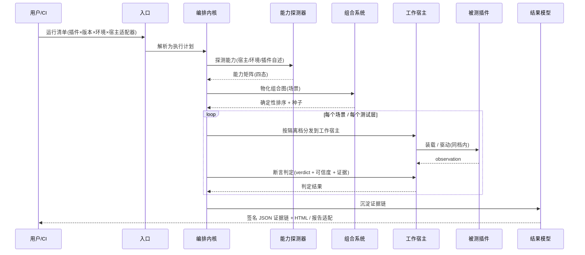
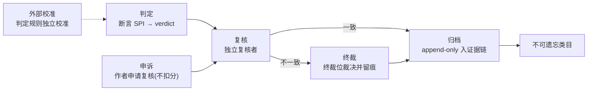
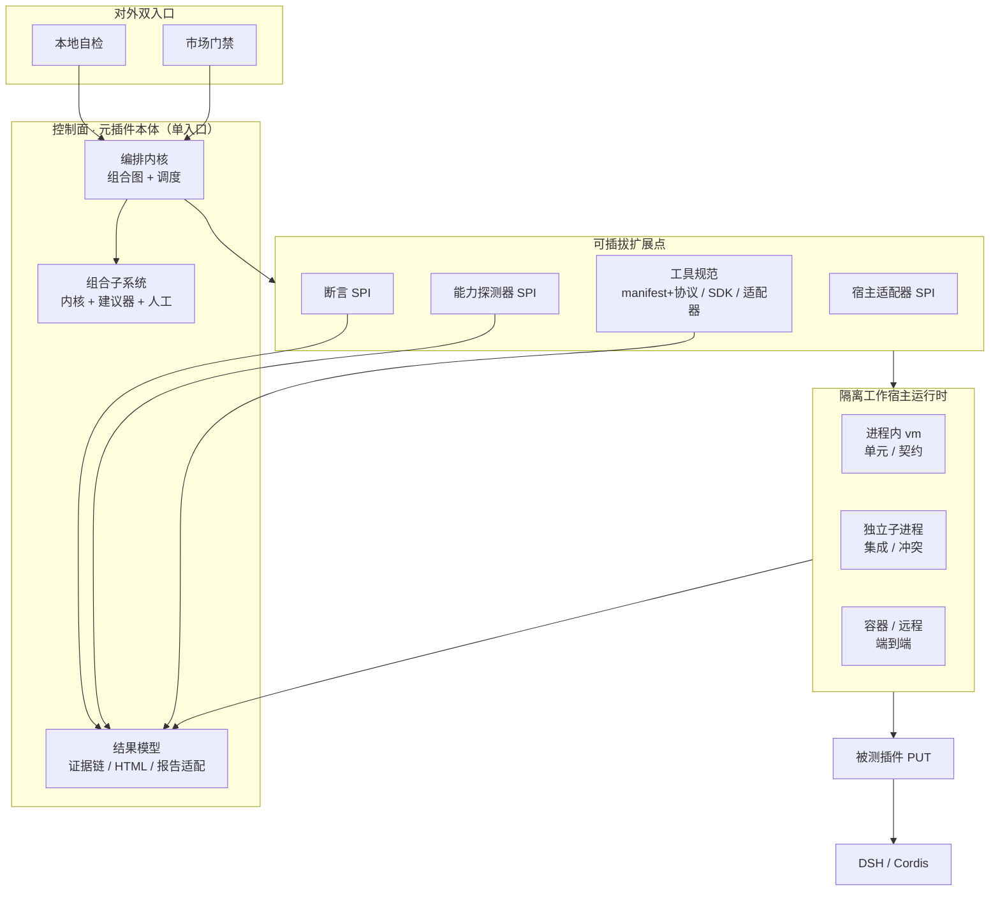
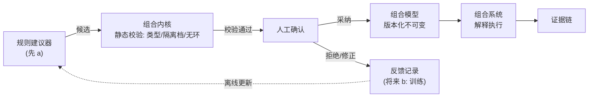

# DSH 插件测试平台 — 架构文档

- 状态：设计定稿（评审已合并，治理面补强见 §15）
- 日期：2026-10-14
- 范围：一个安装进 DSH（DeepSeek Harness）的「元插件」，用来验证其它 DSH 插件
- 理论证明：[theory-proof.md](theory-proof.md)（对本设计关键机制的形式化论证、显式假设与边界）
- 交互图：[architecture.html](architecture.html) · 人读渲染：[architecture.doc.html](architecture.doc.html)

---

## 1. 一句话定位

一个装进 DSH 里的 **元插件**，用 DSH 自己的机制去验证其它 DSH 插件——从无宿主的单元逻辑，到契约、集成、多插件冲突、端到端；从开发者本地自检，到插件市场的统一质量门禁；全程由「可信内核 + 可插拔适配器」这一架构风格贯穿。

---

## 2. 背景与动机

DSH 的插件生态需要一个**统一的验证层**。当前痛点：

- 插件作者缺少一条从「纯函数能跑」到「在真实宿主里能和别人共存」的完整测试链；
- 插件市场的准入缺少**可复现、可审计、不可篡改**的质量证据；
- 没有统一的「契约真源」，插件对 DSH API 的用法只能靠人肉 review。

本平台把这些需求收敛成一套分层、可组合、可扩展的测试能力，并用「确定性优先」保证同一个规格在任何地方跑出同一结论。

---

## 3. 质量属性（目标层）

这是平台要达成的**目标**，不是实现细节：

| 属性 | 含义 |
|---|---|
| **准确性** | 测试结果可复现、可验证、不可篡改 |
| **通用性** | 支持多宿主、多版本、多插件、多环境 |
| **可组合** | 基础工具 → 小场景 → 大场景，层层组合 |
| **可扩展** | 宿主适配器、断言、能力探测器均可插拔 |

---

## 4. 设计原则（约束层）

四条目标靠下面十条**纪律**落地：

| 原则 | 落地含义 |
|---|---|
| 判定精确 | 结果用显式 `verdict` 枚举（pass / fail / skip / error / inconclusive），无隐式「通过」 |
| 可信度显式 | 每个判定绑定证据来源 + 可信级（静态源码 / mock 契约 / 真实宿主 / 重放快照） |
| 规格先行 | 契约与场景先建模成可执行规格，断言与报告由规格生成，不从结果反推 |
| 对象安全 | 平台与测试对象零共享可变状态，只走序列化快照/消息；自制代码按不受信第三方对待 |
| 线程安全 | 异步 / worker / 并发运行安全，并发用例不污染共享状态 |
| 分层职责 | 五层各断言各的对象，不越层（契约层不碰真实宿主内部，集成层不重复单测语义） |
| 确定性优先 | 钉死环境快照/版本矩阵/随机种子/执行顺序/调度；非确定项显式标注 |
| 完整性可验证 | 报告带「应跑清单 / 已跑清单 / 覆盖缺口」，证明无静默跳过 |
| 组合可验证 | 组合规则可静态校验；组合判定是成分判定的确定性函数 |
| 最小信任 | 不信任插件自述与宿主行为，只信外部可观察证据（能力要实测，不轻信声明） |

### 架构风格：可信内核 + 可插拔适配器

几乎每个子系统都是这个形：**内核守确定性/可验证，适配器守通用性/可扩展**。宿主适配器、断言、能力探测器、建议器、报告适配器、工具 SDK/协议，全部复用同一模式。

### 拆分纪律

模块按 **职责边界 + 受信等级 + 变更频率** 切，不按文件大小切；依赖只指向内核或走依赖倒置；SPI 实现不得反向依赖具体宿主或具体插件。高频替换部件（宿主适配器、断言、能力探测器）与稳定内核分开演进。

---

## 5. 形态与执行模型

### 5.1 形态

- **对外是单个插件**（一个安装入口），守住「装进 DSH 的插件」这一前提。
- **对内拆成若干 Cordis 子插件 / package**，每个有自己的 fiber 生命周期、独立版本、独立证据，由根插件 `ctx.plugin(child)` 组装。这正是 Cordis 的天然拆分单位，也是 DSH 自身 monorepo + bundle 的做法。

### 5.2 执行模型 A：控制面 + 隔离工作宿主

平台插件只是 **控制面（orchestrator）**；真正跑被测插件（PUT）的那几层，由平台通过「宿主适配器」**另起隔离的「工作宿主」**执行，而不是就地装进正在运行平台的那个 DSH。

- 理由：就地加载会造成污染、无法测多版本、无法干净卸载——直接破坏「准确性」。
- 控制面与工作宿主只通过序列化快照 / 消息传递，杜绝共享可变状态（对象安全 / 最小信任）。

### 5.3 三档隔离

| 测试层 | 隔离档 | 理由 |
|---|---|---|
| 单元 / 契约 | 进程内 `node:vm`（可复用现成机制） | 白盒、mock ctx，无需强隔离，轻快 |
| 单插件集成 / 多插件冲突 | 独立子进程 worker | 对象安全：崩溃/泄漏不拖垮平台，可测多版本 |
| 端到端 | 容器 / 远程 | 最贴近真实部署 |

> 注：现成 `node:vm` 沙箱明确「不是安全边界」，只能做行为隔离；强隔离靠子进程/容器兜底。

---

## 6. 测试能力全景

**五层执行（由下往上，隔离度逐级降低）**：

1. **单元逻辑** — 无宿主，测插件里不依赖 DSH 的纯函数 / 白盒。
2. **契约** — 用 mock/stub 的 DSH API，校验插件用法（参数/返回/生命周期钩子顺序）。
3. **单插件集成** — 真实宿主 + 隔离工作宿主，验证装配、加载、运行。
4. **多插件冲突检测** — 真实宿主同时加载多个插件，默认「两两组合 + 可指定集合」，检测同名命令/钩子/共享文件/共享状态冲突。
5. **端到端** — 真实宿主 + 真实能力，跑通完整链路。

**两横切维度**：

- **周期验证**：回归 / 性能 / 安全，按调度触发。
- **通用质量手段**：覆盖率 / 模糊测试 / 属性测试，作为手段套用到各层。

> 覆盖率边界：行列/分支覆盖要求可插桩或源码可读；纯二进制黑盒插件只能做行为/接口覆盖。

---

## 7. 核心模块划分（9 个可拆分单元）

| # | 模块 | 职责 | 变更频率 / 受信 |
|---|---|---|---|
| 1 | **编排内核** | 声明式组合图解析 + 执行调度（分发到宿主、收集判定） | 最稳 |
| 2 | **宿主适配器** SPI + 注册表 | 把 vm/子进程/容器抽象成统一接口 | 高（随宿主契约变） |
| 3 | **断言** SPI | 独立「判」：observation + 期望 → verdict + 可信度 + 证据 | 中（随判定策略变） |
| 4 | **能力探测器** SPI | 三探头（宿主/环境/插件自述）→ 能力矩阵 | 高（随宿主+环境变） |
| 5 | **工具规范** + SDK/适配器 | manifest + 调用协议内核；SDK 主路径、协议兜底 | 中 |
| 6 | **组合建议器** + 人工把关 | 产出候选组合，先规则、留 AI 插槽 | 中（独立演进） |
| 7 | **隔离工作宿主运行时** | vm / 子进程 / 容器三档执行 | 中 |
| 8 | **结果模型** | 签名 JSON 证据链 + HTML + 报告适配器 | 中 |
| 9 | **对外双入口** | 本地自检 / 市场门禁 | 低 |

依赖只指向内核或走依赖倒置；SPI 实现不反向依赖具体宿主/插件。

---

## 8. 三大可插拔扩展点（SPI）

### 8.1 宿主适配器

- 三档：进程内 vm / 独立子进程 / 容器·远程。
- 参考实现先做**本地子进程**，容器/远程作为后续适配器插到同一接口后。
- 可复用/对齐现成 `cordis-host-runner`（`define / run / stop / undefine`、`node:vm` 沙箱、插件形态检查、`cordisInspect`）。

### 8.2 断言（独立 SPI，不是工具子类）

- 工具负责「做/观察」，产出 **observation**；断言负责「判断」，产出 **verdict + 可信度 + 证据**。
- 做与判分离：组合图里能分清「观测节点」与「判定节点」，断言可独立插拔、独立演进。

### 8.3 能力探测器

- **三探头全测**：宿主能力、环境能力、插件自述能力 → 归一成一个能力矩阵。
- 信任分级：宿主/环境 = 客观事实，探测即「已验证」；插件自述 = 声明，须**实测通过**才算「已验证」。
- **四态条目**：`已探测存在 / 已探测不存在 / 不可探测 / 仅声明未验证`（分得清支持 / 不支持 / 没证据 / 只是嘴上说）。
- **探测时机按探头分档**：宿主能力 → 缓存 + 版本指纹失效；环境能力（网络/GPU）→ 每次测；插件自述 → 跟插件版本走。
- 能力结果本身也是不可变证据（绑探测时间 / 探测器版本 / 环境快照），历史可追溯。
- 能力在匹配中各司其职：宿主能力 → 哪些契约/集成断言可跑；环境能力 → 能跑到什么程度；插件自述（实测后）→ 断言按能力分派。
- **能力缺失/未验证时判定打 `skip` 或 `inconclusive` 并附证据，绝不产生假 pass/fail。**

---

## 9. 组合子系统

三层，对应「可信内核 + 不受信建议器 + 人工把关」：

### 9.1 组合内核（权威层）

声明式组合图：节点 = 基础工具（自报 I/O 类型 + 隔离档 + 确定性），边 = 依赖/类型/隔离档约束。静态可校验、无环、确定性。是「什么才叫合法组合」和「到底执行了什么」的唯一真相源。

### 9.2 建议器（候选层）

规则引擎（先 a）产出候选组合，将来可换学习模型（留 b 插槽）。输出不受信，必须过内核静态校验 + 人工确认才铸成规格。

### 9.3 人工把关（决策层）

采纳/拒绝/修正建议，记录作为未来「训练」原料（当前规则维护，将来可训练模型）。模型只离线更新、运行时不自动改内核。

- **组合模型可更换（版本化替换 B）**：模型是版本化不可变工件，执行结果绑定「模型版本 + 工具版本 + 种子」；替换须先过内核静态校验、产出替换 diff、报告标注模型来源版本，旧版留档可回滚。schema 版本化演进走迁移规则，不为此改引擎。
- **组合必须隔离档感知**：只能同档直接组合，跨档靠序列化消息桥接，禁止跨档共享可变状态。
- **同档并发隔离**：并发用例/插件实例各占独立工作宿主实例，仅经序列化快照交换，禁止同档共享可变状态（对应 §4「线程安全」的落地）。

---

## 10. 双用户 · 双入口 · 两档信任

**同一个测试规格，在「本地自检」和「市场门禁」两种上下文里跑出同结论**；本地 `gate dry-run` 能预测门禁结果，门禁判过可本地一键复现。

- **本地自检**：单插件为主，快反馈，人读报告友好。
- **市场门禁**：批量、多插件组合、周期扫描，需不可篡改、可审计、可追责。

**两档信任/发布路径**：

- 技术门禁（契约校验 + 首跑探测）恒在，过了即自动可用；
- 人工门禁只在「离开本地、对外发布」时触发。

---

## 11. 结果与证据模型（三层报告）

| 层 | 内容 |
|---|---|
| **权威内核** | 带签名的 JSON 证据链：append-only、内容寻址、绑环境快照 + 工具/模型版本 + 种子；机器可读、可重放验证 |
| **本地面孔** | 可导出 HTML 人读报告 |
| **对外面孔** | 适配器接现成格式（JUnit / TAP 等），CI / 门禁直接消费 |

报告区分「规则校验通过」与「学习建议被采纳」，组合图记录来源（手写 / 建议器+人工确认）；复现以已确认图为准，在线建议不改变历史结果。

---

## 12. 核心数据流（一次运行）



---

## 13. 落地真源与技术选型

- **技术栈**：TypeScript（与 DSH 同栈）。
- **DSH 插件体系 = Cordis**：`@deepseek-ai/cordis` 的 Context / Fiber / Service / Events / Schema。
- **契约真源**：`docs/cordis-api/*` 由 `scripts/gen-cordis-catalog.ts` 从 `vendor/cordis/src/*.ts` 的 JSDoc 自动生成 → 契约层从真源自生成契约清单，不手工维护易过期契约。
- **Fiber 状态机**（生命周期契约）：

  ```
  PENDING → LOADING → ACTIVE → UNLOADING → DISPOSED
                       ↘ FAILED
  ```

- **现成可复用/对齐**：
  - `cordis-host-runner`（`ctx.dynamicCordisRunner` / `ctx.cordisInspect`）— 宿主适配器参照；
  - `tool-cordis`（只读运行时 API 发现）— 能力探测器参照；
  - `ctx.tools.register(...)` + 工具 schema — 工具 manifest 真源参照。
- **场景写法**：声明式 DSL 为主 + 编程式兜底。
- **周期调度**：先 cron / 触发式简单调度器，不引入重任务队列。

---

## 14. 扩展点与风险

### 扩展点

- 三个 SPI（宿主适配器 / 断言 / 能力探测器）+ 工具规范（SDK + 协议适配器）+ 报告格式适配器 + 建议器插槽（规则 → 学习模型）。

### 主要风险 / 待核项

1. **`node:vm` 并非安全边界**：只能做行为隔离；强隔离必须上子进程/容器，且要在文档与实现中显式区分。
2. **现成 `cordis-host-runner` 源码细节待核实**：`cordisInspect`/`tool-cordis` 的精确契约需在实现前逐条对齐（当前设计层仅作参照，未逐行核实）。
3. **能力探测失效触发器完备性**：环境漂移（网络/GPU/系统库）多为无版本号因子，必须靠「环境能力每次测 + 轻量指纹」堵漏，否则缓存漏判会产生假失败。
4. **学习建议器（b）的确定性张力**：仅允许离线更新 + 人工评审发布，运行时绝不自动改内核。
5. **性能/安全验证的可测边界**：黑盒二进制插件只能做行为/接口覆盖，覆盖率口径需按层声明。

---

## 15. 治理面：判定者自身的治理

前文把验证镜头对准被测插件；本节把镜头转向**判定者自身**——平台对插件产出判定、行使裁决，判定与裁决本身同样需要被治理。本面**不是 §7 之外新加的第十个模块，而是一条横切治理层**：它穿透判定层（§8.2）、报告与证据层（§11）、组合层（§9），约束「谁在判、凭什么判、判错了怎么办」。

> 本面由第三方评审（`reviews/2026-10-14-lingshu-ecosystem-architecture-review.md`）的治理缺口催生；文中 F/G 编号仅作溯源注记，不作为章节骨架。

### 15.1 治理对象

被治理的是平台**自己**的四类判断产物：

| 对象 | 含义 |
|---|---|
| **判定 verdict** | 断言 SPI 对一次观测给出的结论（pass / fail / skip / error / inconclusive） |
| **裁决** | 多个判定不一致时，终裁位给出的最终决定 |
| **规则（判据）** | 断言与门禁所依据的判定规则本身 |
| **信誉（通道历史）** | 判定者/断言实现的历史表现；机制（通道可信度）见 §15.7 |

### 15.2 治理角色

| 角色 | 职责 | 载体 |
|---|---|---|
| 判定者 | 产出 `verdict` + 证据 + 可信级 | §8.2 断言 SPI |
| 复核者 | 对 `verdict` 做独立复核（另一断言实现 / 元断言） | §8.2 |
| 终裁位 | 复核不一致时裁决并留痕 | §8.2 判定之上 |
| 监督方 | 使判定理由可审查、可被异议 | §11 证据链 |
| 申诉方 | 被拒插件作者，可申请复核且不扣分 | §10 门禁入口 |
| 外部校准者 | 对判定规则独立校准，声明独立性 | §10 门禁之外 |

> 申诉与校准的落地接口（避免「有名无实」）：**申诉方**提交异议 → 进入 §15.4「复核」节点，结果追加入证据链；**外部校准者**以独立实现对判定规则做抽查比对，比对结果作为校准记录入证据链。二者各对应一条可审计记录，而非仅有名词。

### 15.3 核心不变量（条件性设计不变量）

治理面约束**不是「无条件成立」**，与 `theory-proof.md`（A0–A10，§1.2）同一口径：**在 A0–A10 显式假设下条件性成立**，未核实的设计义务逐条标注；每条不变量必须配**可证伪的检测点**，否则不构成有效约束。

| 不变量 | 依赖假设 | 检测点（可证伪） |
|---|---|---|
| **可异议**：每个 `fail` 附带可被异议的证据与判据，任何方可发起异议（F9） | A10 证据字段（设计义务，待实现核实） | 每条 fail 必带非空 `evidence` 且可定位；申诉入口存在且可触发 → 经 §15.2/§15.4 复核链路并追加入证据链；三者缺一即判不合格 |
| **终裁留痕**：终裁依据与结论 append-only 入证据链，不可删改（F8） | A9 载荷归一化 + A5 载荷域单射（条件性） | 归档副本与证据链逐字节一致；任何「落链后逆改」被拒（只追加） |
| **单向性**：面孔（HTML/JUnit/TAP）是权威证据链的纯函数、只读、禁止反写；纠正靠追加，冲突以权威面为准（G4/F11） | 设计选择 D（面孔纯函数，待实现核实） | 由同一证据链重算面孔并与已发面孔逐字节比对；拒绝「从面孔回填证据链」路径 |
| **免闸留痕**：层/场景被判「不跑」须显式记录「谁判、命中哪条判据」，与 `skip` 区分（F10） | A0 符合性（设计义务，待实现核实） | 报告「免跑依据」字段非空且可对应判据；缺记录即判「闸被静默跳过」 |
| **冗余与不可遗忘**：证据链「本地 + 只读归档」双副本；不可遗忘类目（被推翻判定/覆盖缺口/免闸记录/终裁记录）只追加不删（F13/G7） | A0 符合性（设计义务，待实现核实） | 副本数与归档校验和可核；对不可遗忘类目的写操作被拒（只 append） |

### 15.4 治理主链路（数据流）



### 15.5 与既有模块的接口映射

| 治理不变量 / 机制 | 落点 | 联动 |
|---|---|---|
| 判定 · 复核 · 终裁 | §8.2 断言 SPI | 补「复核义务」与「终裁位」两个角色 |
| 免闸留痕 | §11 证据链（留痕）；运行清单定义见 §12 数据流 / §16 决策记录 | 运行清单增「免跑层/场景 + 依据」字段 |
| 单向性 | §11 结果与证据模型 | append-only 上补「面孔纯函数、不得反写」 |
| 冗余 / 不可遗忘 | §11 | 补双副本策略 + 不可遗忘类目 |
| 递归截断 | §4 判定精确（verdict 枚举含 `inconclusive`）· §8.3 能力探测 | 机制设计见 §15.6 |
| 租约回收 | §13 周期调度（cron）· §6 周期验证 | 机制设计见 §15.6 |
| 学习闭环 | §9 + §8.2 | 机制设计见 §15.6 |
| 版本锚定 | §13 落地真源 | 锁定 DSH/cordis 版本，供外部校准锚定 |

### 15.6 其余治理机制（三处设计）

> 三项机制此前在 §15.5 仅以「to-add」承诺存在，本节给出设计本体；均为**设计承诺**（待实现与机检），非已证结论。

1. **递归截断（G1）**：判定不确定时进入递归追溯——判定 → 复核 → 终裁，每上溯一层深度 +1，默认上限 **3 层**；到达上限仍不确定 → 判 `inconclusive` 并在证据链留痕，**停止猜测**。深度计数不因新增判定者而重置；「层级」＝复核者逐级嵌套追溯的深度，终裁位为该链顶端。
2. **租约回收（G3）**：批量/周期扫描取得的资源（工作宿主实例、临时目录、端口）一律声明为「占位」——**租约是资源的占位，不是权限**。租约带到期时间（TTL）；到期或取消 → **回收释放并留痕**。冲突检测的反复装载/卸载遵守同一「占用 → 到期 → 回收」状态机。
3. **判定层学习闭环（G5）**：断言规则被终裁推翻、或被对抗变异检出判错，即记为一次「失败」；失败 → 记录入证据链 → 规则修正（人工或离线）→ 版本化发布 → 以追加形式回链证据链（新增修正记录，不改历史）。与 §9 组合建议层的学习闭环并列、不共用触发。

### 15.7 通道可信度与对抗集（两处设计）

> 两项此前登记为「实施期待办」，本节升级为设计本体；均为**设计承诺**（待实现与机检），非已证结论。

1. **通道可信度（F14）**：区分「置信度」（单次判断的内部一致性）与「可信度」（判定通道的历史验证命中率）。每个断言实现（判定通道）维护一个可信度，由证据链上的复核/终裁结果驱动更新——每次「复核确认」或「终裁推翻」都是一条样本，可信度 = 贝叶斯后验命中率（确认数 / 总判定数）。判定落地时，其**可信级**＝静态证据分级（源码 < mock < 真实宿主）× 通道历史命中率两维合成，写入 verdict。**检测点**：通道可信度可由证据链重算复核；任何「声称高可信却零历史样本」的通道判为「未验证」。与 §15.3「可异议」联动——复核/终裁的确认与推翻事件正是可信度的样本来源。
2. **对抗集（F17）**：平台对自己的判定能力做「能红」式验证——维护一组已知的错误/恶意注入（故意违规插件、伪造证据、越权操作、隔离逃逸样本），平台必须**全部检出**（100% 检出率），漏检即判定能力缺陷；周期引入新变种（防打补丁）。并将 `theory-proof.md` 列为「非目标」的安全性质（对抗性隔离、黑盒覆盖率）提升为**范围选择**：若平台承担市场门禁，闸在真实攻击下的有效性须由本对抗集证明。**检测点**：对抗集全检出率 = 100%，任一漏检即判 FAIL。

### 15.8 显式化边界

- **硬契约补充**：Fiber 状态机补「**DISPOSED 不可重启**」，引用 cordis `FiberState` 枚举真源，作为 §6 冲突检测的前置约束（F12）。

---

## 16. 决策记录（含「我的拍板」项）

以下标 ⭐ 的为作者在讨论中默认拍板、用户未否决，可改：

| 决策 | 结论 |
|---|---|
| 形态 | 装进 DSH 的元插件 |
| 执行模型 | A：控制面 + 隔离工作宿主 |
| 隔离分档 | vm / 子进程 / 容器（按测试层） |
| 拆分 | 单插件对外，内部 9 个子插件/package |
| 断言与工具 | 断言独立 SPI（判），工具只做/观察 |
| 能力探测 | 三探头全测、四态、分档时机 |
| 组合 | 内核 + 建议器 + 人工；模型版本化可换（B） |
| 工具规范 | manifest + 协议内核，SDK 主路径，适配器兜底 |
| 用户 | 本地自检 + 市场门禁，两者都要 |
| 结果 | 签名 JSON 证据链 + HTML + 报告适配器 |
| ⭐ 技术栈 | TypeScript |
| ⭐ 场景 DSL | 声明式为主 + 编程式兜底 |
| ⭐ 运行声明 | 运行清单 = 矩阵（插件×版本×环境×宿主适配器）+ 场景选择 |
| ⭐ 性能/安全 | 性能=加载/启动/内存/API 往返；安全=越权访问/注入/泄密/沙箱越界 |
| ⭐ 周期调度 | cron / 触发式简单调度器 |
| ⭐ 工作宿主参考实现 | 先本地子进程，容器/远程后续 |
| 治理面 | 新增 §15：判定复核/终裁、监督申诉/外部校准、免闸留痕、副本冗余、递归截断、租约回收、判定层学习闭环、账本单向性 |

---

## 附图

### 图 1：架构总览（分层/组件）



### 图 2：组合子系统闭环

