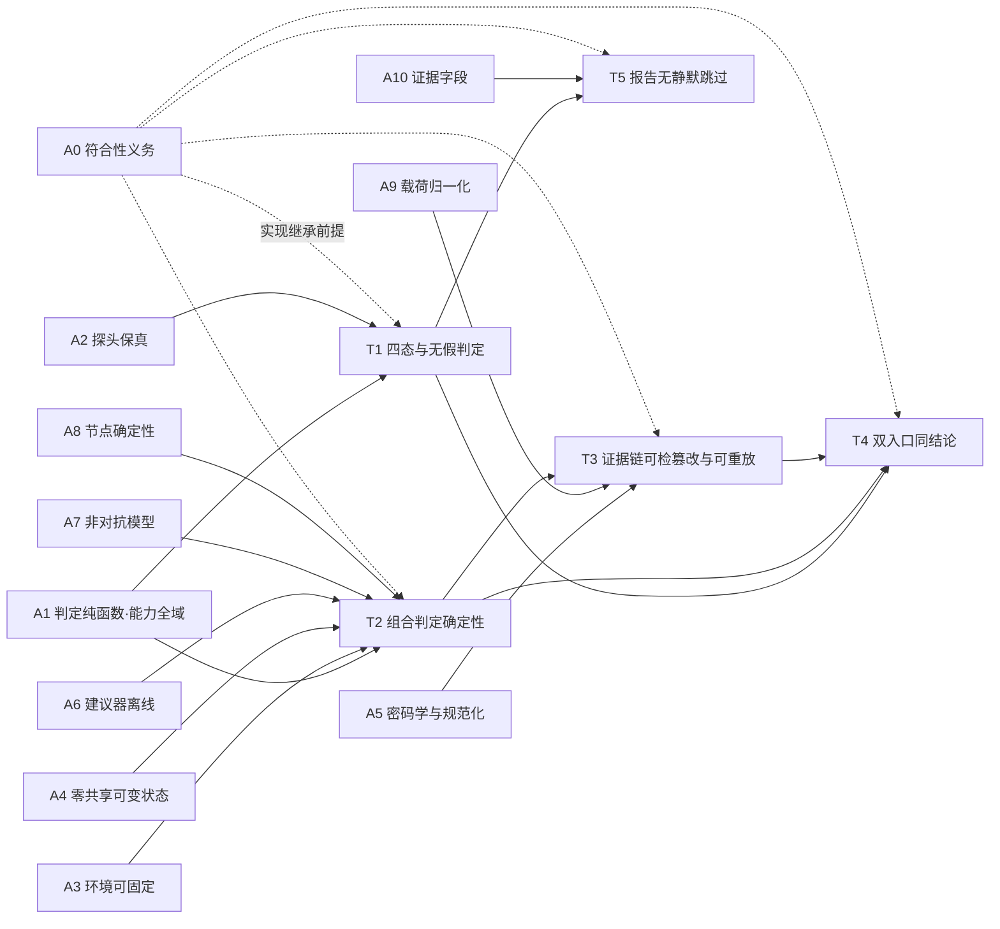

# DSH 插件测试平台 — 理论证明

- 状态：证明稿 · 第 5 版（已按四轮独立对抗式评审修订，修订记录见附录 C）
- 日期：2026-10-14
- 证明对象：[architecture.md](architecture.md) 所描述的设计模型 **M**（该文件 sha256 `ecbb01e2e8ff426a4550c443844029ac82c42a11989db3704f90d227d6101f17`）
- 机检脚本：[theory-model-check.mjs](theory-model-check.mjs)（sha256 `8f3bca3bbf57b7fc3d06f4e91192988079e7516ca842062d29217576525d6c69`，611 行）
- 证据日志：[theory-model-check.log](theory-model-check.log)（sha256 `cc91aabd89d48aaf2530be6c569ed6b54adb4fc71956197c894ae1dced4a6e2d`，`node v24.21.0`）
- 形式化层级：**半形式化**——给出形式定义、引理、证明与假设边界，关键不变量由可执行模型做自洽复核与必要性反例；不构建机器可验证证明（不做 Coq/Lean 级形式化）

---

## 0. 定位、非目标与证明强度

本文对 M 的**关键机制**做演绎论证，而不是复述 §3/§4 的每一条质量属性。

**证明的是**：在显式假设 A0–A10 下，五个机制性命题成立（能力探测无假判定、组合图判定确定性、证据链可检篡改且在 A9 下可重放、双入口同结论、报告无静默跳过）。

**证明的不是**：

1. **实现性质**——M 尚无实现。结论属于设计模型；实现要继承结论须先满足符合性义务（A0）。
2. **无条件成立性**——每条定理绑定假设与边界（第 4 节）；依赖未证假设的结论标注为**条件性成立**。
3. **安全性、性能、通用性、可扩展性**——非目标（§3 的另三条质量属性留作后续）。

### 0.1 证明强度标注（第 2 版收紧）

| 标记 | 含义 |
|---|---|
| 内证 | 在列出的假设内、由定义演绎成立 |
| 双实现复核 | 该命题的**对应不变量**由两个独立实现交叉验证通过（机检中可以失败） |
| 有齿 | 机检含"错误模型必须被检出"的反证；无此反证的检查只能算定义自洽复核 |
| 条件性 | 结论依赖某个目前未证/未核实的假设 |
| 无机检 | 该命题没有被机检覆盖（无实现可测），只有内证 |

**关键澄清**：机检脚本不读取 [architecture.md](architecture.md) 文本、也不是 M 的实现。它的价值是①发现形式定义内部矛盾，②用"错误模型必须被检出"的反证给定义检查装上牙齿。**它给不出独立 oracle**；对 T1/T3/T5 这类本质上是"定义即结论"的命题，机检只能证明定义自洽，不能证明定义正确。

---

## 1. 形式化基础

### 1.1 记号与引用约定

**引用约定**（对 [architecture.md](architecture.md)）：

- `§n` 指该文档第 n 节；`§n.m` 指 §n 内第 m 个编号条目/子节（如 §8.3 = 「能力探测器」、§9.1 = 组合子系统三层中的「组合内核」）。
- `§9 末` = §9 末尾两条独立约束：版本化替换 B、隔离档感知。
- `§11 末` = §11 最后一段：报告区分规则校验与建议采纳；复现以已确认图为准，在线建议不改变历史结果。
- `§14 x` = §14「主要风险 / 待核项」第 x 条风险项。

| 记号 | 含义 |
|---|---|
| $S = \{P, A, U, D\}$ | 能力条目四态：$P$ 已探测存在、$A$ 已探测不存在、$U$ 不可探测、$D$ 仅声明未验证（§8.3） |
| $V = \{\text{pass}, \text{fail}, \text{skip}, \text{error}, \text{inconclusive}\}$ | 判定枚举（§4 判定精确） |
| $\text{probe} \in \{\text{present}, \text{absent}, \text{failed}\}$ | 探头观测；$\text{failed}$ = 没拿到证据 ≠ 不存在 |
| $\text{decl} \in \{0,1\}$ | 插件自述是否声明该能力 |
| $s(\cdot)$ | 能力矩阵：能力名 → $S$（假设 $s$ 在 $\text{req}(a)$ 上全域，见 A1） |
| $B$ | 绑定元组 $(\text{envSnapshot}, \text{工具版本}, \text{模型版本}, \text{种子}, \text{执行顺序})$（§4 确定性优先、§11 绑定项）；$B_{s}$ = 限制到规格 $s$ 的绑定 |
| $G = (N, E, \tau, \iota, b)$ | 组合图：隔离档 $\tau: N \to \{\text{vm},\text{proc},\text{container}\}$、I/O 类型 $\iota$、跨档桥接标志 $b: E \to \{0,1\}$（§9.1） |
| $\text{valid}(G)$ | 静态合法谓词（定义 2.1） |
| $H$ | 内容寻址哈希（实现取 SHA-256） |
| $\text{canon}(\cdot)$ | 规范化序列化；$l_i$ 为证据链第 $i$ 条链接值，$\text{root} = l_n$（§11） |
| $p_i$ | 第 $i$ 条**入链载荷**（record 中参与哈希的判定记录） |

### 1.2 假设清单 A0–A10

- **A0（符合性义务）** 本文结论针对 M；实现只有通过与 M 的一致性测试后才继承结论。
- **A1（判定纯函数且能力全域）** 断言判定是纯函数 $\rho(a, o, e, \text{err}, s) \to V$，不含时间、随机与外部状态（§8.2 做与判分离、§4 判定精确）；能力矩阵 $s$ 在 $\text{req}(a)$ 上全域（每条断言的必需能力都有确定状态）。缺此全域性 $\rho$ 在未知能力上无定义。
- **A2（探头保真）** 探头观测可归一为 $(\text{probe}, \text{decl})$，且 $\text{present}/\text{absent}$ 是对被测对象的**客观事实**（§8.3 信任分级）。这是探测器 soundness 假设；§14 风险 2 指出适配器契约尚未逐行核实。
- **A3（环境可固定）** 存在有限可记录的 $B$ 使同一规格可复现；环境漂移可被"环境能力每次测 + 轻量指纹"探测。§14 风险 3 把缓存漏判列为待核项，**未给出完备性论证**，故 A3 记为**脆假设**。
- **A4（零共享可变状态，含信道清单）** 平台与被测对象之间、以及**并发可执行的组合节点之间**均无可写共享状态；跨隔离档只经序列化消息桥接。信道清单（**均须为空**）：进程内共享内存/模块级可变状态、文件系统、端口、网络、环境变量、缓存。依据：§4 对象安全、§4 线程安全「并发用例不污染共享状态」、§9 隔离档感知。**§9 只禁止跨档共享，不足以覆盖同档并发**，故此处显式针对同档加强（这是本文的设计约束，不是从 §9 推出的结论）。
- **A5（密码学与规范化）** $H$ 在威胁模型内抗碰撞、签名不可伪造（§11）；且 $\text{canon}$ 在**载荷域上单射**——不同载荷不映射到同一字节串（判定是载荷的投影，故载荷域单射蕴含判定域单射）。
- **A6（建议器离线）** 只有"离线更新 + 人工确认"后的版本化模型才能进入内核，运行时建议器不改变内核（§9.2/§9.3、§14 风险 4）。
- **A7（非对抗故障模型）** 进程内 `node:vm` 只提供行为隔离，不提供安全隔离（§5.3 注、§14 风险 1）。这是**范围限制**，把 T2 的隔离结论限定在崩溃/泄漏/污染这类非对抗故障内。
- **A8（节点确定性）** 组合图中每个节点在固定 $B$ 下是其输入与 $B$ 的确定性函数；随机节点的随机性全部由 $B$ 内的种子驱动（§4 确定性优先）。此假设第 2 版显式列出——它不是从 §9.1 推出的。
- **A9（载荷归一化）** 入链载荷 $p_i$ 是 $(\text{判定}_i, B)$ 的确定性函数：运行期可变字段（时间戳、临时路径、耗时读数、未归一化的原始证据串）**不进入载荷**；且 $\text{canon}$ 是**键序不敏感**的规范序列化（同一内容的不同书写顺序必须得到同一字节串）。**这是 T3 反向（判定一致 ⇒ root 相等）成立的必要条件**，见 §2.3 的反例记录。注意：把可变字段"并入 $B$"并不能救回 T3(2)——那样 T3(2) 的"绑定相同"前提就不成立，只能退回 T3(1) 的载荷级重放。
- **A10（证据字段存在）** 每条判定记录携带证据来源与可信级字段（§4 可信度显式、§8.3 能力缺失须附证据）。T5 的第三合取项依赖此假设，**不是 T1 的推论**。

### 1.3 设计选择 D1–D2

以下不是假设，而是**设计选择**；证明依赖它们，但它们可改（改了结论的条件随之改变）：

- **D1（规范序规则）** 调度顺序取 Kahn + 节点 id 字典序 tie-break。该规则定义在定义 2.2；"顺序唯一"由引理 2.2 **推导**，不作为假设。（上一稿把它误列为假设 A5，已修正——那会使 T2 条款 1 循环。）
- **D2（双入口同一内核映射）** 本地自检与市场门禁对同一规格 $s$ 使用同一个"规格→执行计划"内核函数（§10）。T4 依赖此设计选择；若两个入口各有一套映射实现，T4 不成立。

### 1.4 定理依赖关系



---

## 2. 定理主链

### 2.1 T1 能力四态构成分割，且缺失/未验证能力不产生假 pass/fail

**条款绑定**：§8.3（四态、信任分级、不产生假 pass/fail）、§4（判定精确、可信度显式、最小信任）。

**定义 1.1（归一函数 $\eta$）**

$$
\eta(\text{probe}, \text{decl}) =
\begin{cases}
P, & \text{probe} = \text{present} \\
A, & \text{probe} = \text{absent} \\
U, & \text{probe} = \text{failed} \wedge \text{decl} = 0 \\
D, & \text{probe} = \text{failed} \wedge \text{decl} = 1
\end{cases}
$$

**引理 1.1（全域性与四态分割）** $\eta$ 在 6 个组合上处处有定义，像恰为 $S$，四态原像类两两不交。

*证明.* 对 $\text{probe}$ 三分支即得全域性；像覆盖由 $(\text{present},\cdot)\to P$、$(\text{absent},\cdot)\to A$、$(\text{failed},0)\to U$、$(\text{failed},1)\to D$ 给出，反向按定义成立，故 $\text{Im}(\eta)=S$；$\eta$ 是函数，故原像类不交。∎

> **解释性选择**：$(\text{absent}, \text{decl}=1)$ 归入 $A$ 而不新增第五态（"声明冲突"），依据 §8.3「插件自述 = 声明，须实测通过才算已验证」与 §4 最小信任。冲突作为条目上的注解信号记录，不进入状态枚举。

**定义 1.2（判定 ρ 为优先链）** 按序取首个命中的分支：

| 序 | 分支条件 | 结果 |
|---|---|---|
| 1 | $\text{err}$ | `error` |
| 2 | $\exists c \in \text{req}(a): s(c) = A$ | `skip` |
| 3 | $\exists c \in \text{req}(a): s(c) \in \{U, D\}$ | `inconclusive` |
| 4 | $\forall c \in \text{req}(a): s(c) = P$ | $\text{compare}(o,e) \in \{\text{pass}, \text{fail}\}$ |

> **解释性选择（须评审）**：§4/§8.3 未规定"$A$ 与 $U/D$ 并存"的先后。本文取"已探测不存在（确定性不适用）优先于不可探测/仅声明"，即上表序 2 先于序 3。分支 1–3 与 4 的守卫**不是互斥分割**而是优先链；序 2/3 可同时为真（如一个必需能力为 $A$、另一个为 $U$），此时取 `skip`。

**定理 T1（无假判定）** 在 A1、A2 下：

$$
\rho \in \{\text{pass}, \text{fail}\} \iff \text{err}=0 \wedge \forall c \in \text{req}(a): s(c) = P
$$

*证明.*（$\Leftarrow$）全 $P$ 时分支 1–3 条件全假、分支 4 命中，取 $\text{compare}(o,e)$，由 A1 其值为 pass 或 fail（能力全域性保证分支 4 的条件有定义）。（$\Rightarrow$）设 $\rho \in \{\text{pass},\text{fail}\}$。若 $\text{err}$ 为真则分支 1 命中得 `error`，矛盾；否则分支 4 必命中（$\rho$ 落在其值域内），而分支 4 的条件正是 $\forall c: s(c)=P$。∎

**推论 1.1（最小信任）** $s(c) = P \iff \text{probe} = \text{present}$（引理 1.1 的原像类），与 $\text{decl}$ 无关。故"嘴上说支持"永不产生 pass/fail。∎

**推论 1.2（合取）** 任一必需能力非 $P$ ⇒ 判定不属于 $\{\text{pass},\text{fail}\}$；全 $P$ ⇒ 由 $\text{compare}$ 唯一决定。由 T1 代入。∎

**机检（P1，`definitional+teeth`，148 例）**：6 组合全域、四态像类、$\eta$ 最小信任反证（声明优先的错误实现必须被检出）、守卫链穷尽性（16 个子集 × 2 种 err 均有分支命中）、首选命中与实现一致、优先级约定（$A$ 先于 $U/D$）、留空与错误优先级两个"必须被检出"的反证、无假判定的错误实现反证。

**条件性**：依赖 A2。若探测器把"探不到"误报为 $\text{present}$，T1 直接失效；§14 风险 2 的适配器契约核实是 T1 的实现前置条件。

---

### 2.2 T2 合法组合图的执行与判定是确定的

**条款绑定**：§9.1（无环、静态可校验、确定性、唯一真相源）、§9 末（隔离档感知）、§4（组合可验证、确定性优先、对象安全、线程安全）、§9 版本化替换 B、§11 末。

**定义 2.1（静态合法谓词）**

$$
\text{valid}(G) \iff \text{acyclic}(G) \wedge \underbrace{\forall (u,v)\in E:\ \tau(u)=\tau(v) \vee b(u,v)}_{\text{隔离档约束}} \wedge \underbrace{\forall (u,v)\in E:\ \iota_{\text{out}}(u)=\iota_{\text{in}}(v)}_{\text{类型约束}}
$$

**定义 2.2（规范序 D1）** $\text{order}(G)$ = Kahn 过程每轮从入度 0 的待选节点中取 id 字典序最小者所得的序。

**引理 2.1（无环 ⇒ 拓扑序存在）** $\text{acyclic}(G) \Rightarrow \text{order}(G)$ 含全部节点。

*证明.* Kahn 论证：无环有向图至少有一个入度 0 节点；删除一个入度 0 节点后剩余图仍无环，过程持续至节点耗尽。∎

**引理 2.2（规范序唯一且与输入顺序无关）** $\text{order}(G)$ 是 $G$ 的函数，不依赖 $N, E$ 的列举顺序。

*证明.* 归纳：每轮"入度 0 的未访问节点集"仅由 $G$ 与上一轮删除集决定，而删除集由归纳假设唯一确定，其最小元唯一；故本轮选中节点唯一。∎

**引理 2.3（并发可交换）** 在 A4 下，$\text{order}(G)$ 中无依赖路径的两节点并发执行时，任意交错产生相同输出向量。

*证明.* 两节点间无依赖路径。若二者可互相影响，则存在一条信道（A4 信道清单）携带可写状态：跨档通信必为序列化消息，而消息必有显式边（否则不是通信）——与无路径矛盾；同档并发共享内存/文件/端口/网络/环境/缓存——被 A4 逐项排除。故二者状态分区不交，效果可交换。∎

> **该引理的地位（第 2 版澄清）**：A4 已直接规定并发节点状态分区不交，因此引理 2.3 是把该设计约束**转写成判定唯一性的一步**，而不是从 §9 推出的新事实。它**没有机检**（无实现可测并发语义）；P2 只给出"违反 A4 会怎样"的必要性反例（共享计数器下两种交错得到不同结果）。

**定理 T2（判定确定性）** 在 A1、A3、A4、A6、A7、A8 与 D1 下，若 $\text{valid}(G)$：

1. 存在唯一的执行顺序 $\text{order}(G)$；
2. 各节点输出唯一；
3. 对固定 $B$，复合判定 $\text{Verdict}(G,B)$ 唯一且可复现。

*证明.*（1）引理 2.1、2.2。（2）对 $\text{order}(G)$ 归纳：节点输入全部来自严格在前节点（拓扑序性质），由归纳假设输入唯一，再由 A8 节点确定性得输出唯一；并发分支由引理 2.3 不改变结果。（3）复合判定是各节点判定的聚合，各节点判定是 A1 的纯函数 $\rho$ 作用于唯一观测的结果，故唯一；重复执行需要同一 $B$，由 **A3** 保证可复现，由 A6 排除运行时建议器改写内核；A7 限定本结论只覆盖非对抗故障模型（范围限制）。∎

**定理 T2′（版本化替换的安全性）** 设模型是版本化不可变工件，且 $M'$ 的节点同样满足 A8。若 $M \to M'$ 的替换满足 $\text{valid}(M')$ 并产出替换 diff、结果绑定模型版本，则：

1. 历史结果（对 $(M,B)$ 的记录）不受 $M'$ 影响；
2. $M'$ 的引入不破坏确定性，回滚 $M$ 可复现旧结果。

*证明.*（1）由 T2，历史结果是 $(M,B)$ 的函数；由 §9 版本化替换（模型不可变）与 §11 append-only 记录，$M'$ 不能改写既有记录。（2）$M'$ 过静态校验且节点满足 A8 ⇒ 满足 T2 前提 ⇒ 其结果对 $(M',B)$ 确定；保留旧版本工件 ⇒ 以 $(M,B)$ 重放即得旧结果。∎

**必要性（去掉哪条会塌）**

| 去掉 | 反例 / 后果 |
|---|---|
| 无环性 | 有环则无拓扑序，"先跑谁"未定义 ⇒ 条款 1 失效 |
| D1 tie-break | 合法拓扑序不唯一 ⇒ **仅条款 1 失效**（A4 下判定仍唯一）；若连 A4 一起去掉，才进一步导致判定不唯一 |
| 隔离档约束 / A4 | 共享计数器：$u$ 自增、$v$ 读取，两种交错得到不同观测 ⇒ 判定不唯一（P2 已机检该反例成立） |
| A8 节点确定性 | 节点输出依赖未绑定的内部状态 ⇒ 条款 2 失效 |
| 种子/版本绑定（$B$） | 随机节点两次运行采样不同 ⇒ 判定可能翻转（P2 以语义化 LCG 抽样检过种子敏感性） |

**机检（P2，`partial`，67834 例）**：

- **双实现复核（环检测）**：全部 **16 条有序对（含 4 条自环）** 的 $2^{16}=65536$ 个子图上，Kahn 与独立的三色 DFS 的**环判定**必须一致（这是有齿的比较：变异体 M2/M7 都在此失败）。含自环的子图被计入并单独断言非空，故"自环必须被**无环**规则拒绝"确被行使——为此节点 `n4` 取 `out === in`，使自环无法被类型规则顺带拒绝（第 2 版此处只靠类型规则，等同一个漏检；已修正）。**不再**声称"节点覆盖数被独立核对"：那类等式在无环时由算法定义直接蕴含，属空真（第 4 版按评审删除）。
- **双实现复核（合法谓词）**：隔离档与类型两个合取项由**两张独立解析出的节点表**（对象表 vs 规格字符串表）分别求值后比较；同档 2 边 × 跨档 4 边的 3 状态配置（`absent`/未桥接/桥接）穷举 4×81 组，并分别存在"因隔离档非法"与"因类型不符非法"的非空反例（断言计数 > 0）。环判定两种实现另作比较（Kahn vs DFS）；不再保留"`impl.valid === def.valid`"这一自比较（第 2 版残留，已删除）。
- **节点取值与入边列举顺序无关**：对含两条入边的节点，打乱边数组后取值不变（去掉 `runPure` 的入边排序即失败）。
- **必要性反例（有齿）**：同一执行器 + 共享状态存储 ⇒ 两交错下**各节点最终读数**不同；换成私有状态存储 ⇒ 相同；语义化 LCG 抽样不同种子给出不同读数。
- **演示（非有齿，脚本内标注 `演示`）**：确定性节点重复执行一致、有状态执行器漂移——由构造保证，仅说明 A8 的必要性方向。
- **不覆盖**：引理 2.3 的并发语义本身、T2 条款 3 的实际重放，均无机检。

**条件性**：A7 使"隔离"只是行为隔离。把 T2 读成安全隔离在 `node:vm` 档是**错误推断**（§14 风险 1）。

---

### 2.3 T3 证据链可检测篡改，且在 A9 下可重放验证

**条款绑定**：§11（append-only、内容寻址、绑环境快照 + 工具/模型版本 + 种子、可重放验证）、§3（准确性）、§4（可信度显式）。

**第 2 版修订说明（重要）**：上一稿把 T3 写成双向命题"root 相等 $\iff$ 判定逐条一致"，该命题**为假**——载荷除判定外还含证据/耗时等运行期可变字段，判定一致不蕴含载荷一致。下面拆成三条引理 + 一个条件化定理，并保留可执行反例。

**定义 3.1（链构造）** 对载荷序列 $p_1..p_n$：

$$
l_0 = H(\text{GENESIS} \| \text{canon}(B)),\quad h_i = H(\text{canon}(p_i)),\quad l_i = H(l_{i-1} \| h_i),\quad \text{root}=l_n,\quad \sigma=\text{Sign}(\text{root})
$$

$B$ 经 $l_0$ 进入链，故 root 绑定环境快照、工具/模型版本与种子。其中 $\text{canon}$ 按 A9 取**键序不敏感**的规范序列化；数组顺序仍是语义（链是 append-only，条目次序本身参与哈希）。

**引理 3.1（篡改可检）** 在 A5 下，$p_i' \neq p_i \Rightarrow \text{root}' \neq \text{root}$。

*证明.* 由 A5 载荷域单射，$\text{canon}(p_i') \neq \text{canon}(p_i) \Rightarrow h_i' \neq h_i$（否则构造 $H$ 碰撞，违背 A5）$\Rightarrow l_i' \neq l_i \Rightarrow$ 向后逐项传播 $\Rightarrow \text{root}' \neq \text{root}$。∎

**引理 3.2（顺序与截断可检）** 交换两条目或删除尾部条目使 root 变化（或长度计数不匹配）。

*证明.* 交换时 $l_i$ 的输入对调、$\text{canon}$ 不同 ⇒ $h$、$l$ 随之不同（A5）⇒ root 变。截断时条目数变化；若末链值恰相等则构成 $H$ 碰撞，违背 A5。∎

**引理 3.3（A9 下的载荷确定）** 在 A9 下，判定逐条一致且绑定相同 ⇒ 载荷逐条一致。

*证明.* 由 A9，$p_i$ 是 $(\text{判定}_i, B)$ 的确定性函数；两条件给出相同的自变量，函数值相同。∎

**定理 T3（可重放验证）** 在 A5 与 A9 下，以 $C$ 中记录的同一 $B$ 重跑同一规格：

1. $\text{root}(\text{replay}(B)) = \text{root}(C) \iff$ 重放载荷与记录载荷逐条一致；
2. 若 A9 成立，则上式 $\iff$ 重放判定与记录判定逐条一致。

*证明.*（1）$\Rightarrow$：由 A5 抗碰撞，同一 root 的相异链必在某 $l_i$ 分歧；$i=0$ 得 $B$ 不同（与前提矛盾），$i\ge1$ 得某 $h_i$ 不同 ⇒ 由载荷域单射得该载荷不同。$\Leftarrow$：载荷逐条一致且 $B$ 相同 ⇒ 同一链构造 ⇒ root 相同。（2）由引理 3.3 双向代入。重放判定本身与记录一致另由 T1（$\rho$ 纯函数）与 T2（执行确定）保证，A3 保证两次运行取到同一 $B$。∎

**反例记录（A9 的必要性，已机检）**：取同一 $B$、判定向量同为 `['pass','skip']`，但证据字段为 `obs#7 latency=12ms` 与 `obs#7 latency=31ms`。实测两链 root **不同**（P3 3d）。故**没有 A9 就没有 T3(2)**；T3(1) 始终成立。设计含义：报告入链前必须归一化运行期可变字段，否则"可重放"退化为"载荷级可重放"。

**机检（P3，`partial`，17 例）**：链式与 Merkle 两种独立构造逐条篡改均检出、重排/截断检出、$B$ 四个分量任一变化改变 root；A9 双向演示（另有 1 条纯幂等断言在脚本内标注为 `演示`，不计入有齿）——**正向**用两份独立构造的同判定载荷（仅键序不同，并断言朴素 `JSON.stringify` 对键序敏感）验证 `canon` 键序无关；**负向**用恰为本文记录的两条载荷 `['pass','skip']`、证据漂移 `latency=12ms`/`31ms` 验证 root 不同。

**条件性**：方向 2 依赖 A9（设计义务，M 尚未实现）；整条 T3 的实际重放依赖 A3（脆假设，§14 风险 3）。

---

### 2.4 T4 同一规格在双入口得到同结论

**条款绑定**：§10（双入口同结论、dry-run 可预测、门禁判过可本地复现）、§11 末（复现以已确认图为准）、§4（规格先行）。

**定理 T4（双入口一致）** 在 T1、T2、T3、D2 下，对同一规格 $s$ 与其规范绑定 $B_s$，本地自检与市场门禁对 $s$ 的**内核判定**一致；`gate dry-run` 的预测等于门禁对 $s$ 的结果。

*证明.* 由 D2，两入口对同一 $s$ 调用同一个"规格→执行计划"映射，其后只经过内核纯函数序列 $(\eta, \text{valid}, \text{order}, \rho, \text{chain})$。入口差异只在被处理规格的**集合**与调度（单插件 vs 批量）、以及是否发布证据。对 $s$ 与 $B_s$，两侧自变量相同 ⇒ 由 T2 判定唯一 ⇒ 判定一致。dry-run 与正式门禁共用该函数，只跳过发布步骤。∎

**条件与边界（第 2 版收紧）**：

- $B$ 含**执行顺序**。门禁是批量/多插件，本地是单插件，二者的整体 $B$ **通常不同**；因此 T4 只对**限制到规格 $s$ 的 $B_s$** 成立，且只对 $s$ 的内核判定成立，不对"整批报告"成立。
- 若两侧 $B_s$ 也不同（环境快照不同），结果可合理地不同——报告须记录 $B_s$ 才能审计差异。
- §10 与本文 §0 的"同结论"一词按上述限定理解；**T4 未做机检**（无实现）。

---

### 2.5 T5 报告完整：无静默跳过

**条款绑定**：§4（完整性可验证、规格先行）、§6（覆盖率边界）、§8.3（能力缺失打 skip 并附证据）。

**定义 5.1** 应跑清单 $R$ 是由已确认规格生成的**集合**（**先于**能力门控，不反推自结果）。运行把每个 $i \in R$ 归入唯一桶 $b(i) \in V$。

**定理 T5（五桶分割不变式）** 在 §4 规格先行与 A10 下，报告满足：

$$
\forall i \in R:\ \big|\{v \in V: i \in \text{bucket}_v\}\big| = 1
\ \wedge\ \bigcup_{v\in V}\text{bucket}_v = R
\ \wedge\ \forall i \in \text{bucket}_{\text{skip}}\cup\text{bucket}_{\text{inconclusive}}:\ i \text{ 带原因与证据}
$$

*证明.* 规格先行使 $R$ 在运行前确定且与结果无关；内核按 $R$ 枚举、对每条调用 $\rho$ 并打标入桶，入桶函数以 $i$ 为定义域全域且单值 ⇒ 唯一归属；枚举覆盖 $R$ ⇒ 并集相等。第三合取项由 **A10** 提供（每条判定带证据字段）；软判定必须附证据是 §8.3 对能力缺失的要求。完整性检测器重算分割并与报告比对，可发现任一破坏。∎

**必要性**：若 $R$ 改为"从结果反推"（§4 明令禁止），`skip`/`inconclusive` 条目会自然消失，静默跳过不可检——故"规格先行"是 T5 的必要条件。

**机检（P4，`partial`，378 例）**：$2^6=64$ 个子集的正向分割，以及"静默丢弃 / 重复归属 / 软判定缺证据 / **多出外来条目** / **外来 id 顶替必需 id**"五类否定反例（后两类分别行使长度守卫与成员守卫；第 2 版这两条守卫单独移除仍全绿，已修正）；$R$ 含重复 id 时按集合语义去重（直接以重复入参检验）。

**边界（第 2 版补充）**：P4 只检查证据字段**非空**，**无法识别伪造证据**；T5 的"完整"是相对已声明口径 $R$ 的完整，不主张真实缺陷覆盖完备（§14 风险 5、§6 覆盖率边界）。两者不可混淆。

---

## 3. 可执行证据

```
$ node theory-model-check.mjs
theory-model-check — architecture.md 抽象模型自检
node v24.21.0
  ✓ P1 能力四态与判定纪律  [definitional+teeth]  (cases=148, failed=0)
  ✓ P2 组合图可校验性与确定性  [partial]  (cases=67834, failed=0)
  ✓ P3 证据链篡改检测与重放  [partial]  (cases=17, failed=0)
  ✓ P4 完整性五桶分割  [partial]  (cases=378, failed=0)
  注: 引理 2.3（并发可交换）本身无机检；P2 只含"违反 A4 会怎样"的必要性反例。
  注: T3 的"判定一致 ⇒ root 相等"方向依赖 A9（载荷归一化），由 P3 3d 显式演示。

PASS — total cases=68377
$ echo $?
0
```

| 检查 | 覆盖 | 诚实分类 |
|---|---|---|
| P1 能力四态与判定纪律 | T1、引理 1.1、推论 1.1/1.2 | **定义自洽 + 有齿**（含错误实现/错误优先级/守卫留空反证） |
| P2 组合图可校验性与确定性 | T2 条款 1、引理 2.1/2.2、定义 2.1 | **双实现复核 + 部分有齿**（环检测含自环、合法谓词、入边顺序三项）；引理 2.3 与条款 3 **无机检** |
| P3 证据链篡改检测与重放 | 引理 3.1/3.2、T3(1)、A9 双向 | **双实现有齿**（链式 vs Merkle）；A9 正/负两向均已构造 |
| P4 完整性五桶分割 | T5 | **否定方向有齿**（丢弃/重复/缺证据/多外来条目/外来 id 五类），正方向由构造；伪造证据不可检 |

### 3.1 变异测试：机检"有齿"的可复现证明

单靠"断言通过"无法排除断言本身空转。故用变异测试反证：注入 9 个已知错误模型，要求**每个变异体必须被检出**（[theory-model-mutations.sh](theory-model-mutations.sh)，日志 [theory-model-mutations.log](theory-model-mutations.log)，sha256 `35d45cd2b16861925eaa0bfccaf785a565ccf6aefad290820aac3ac4157aeb45`）：

```
theory-model-check 变异测试（每个变异体都必须被检出）
  baseline    exit=0  PASS — total cases=68377
  detected    M1 合法谓词丢掉隔离档+类型合取 (valid := noCycle)  (exit=1)
  detected    M2 Kahn 的 acyclic 恒为 true  (exit=1)
  detected    M3 判定优先链把 U/D 提到 A 之前  (exit=1)
  detected    M4 canon 退回键序敏感的 JSON.stringify  (exit=1)
  detected    M5 状态分区不交的断言改用共享存储  (exit=1)
  detected    M6 能力归一让声明覆盖客观探测  (exit=1)
  detected    M7 三色 DFS 对自环视而不见  (exit=1)
  detected    M8 节点取值丢掉入边排序  (exit=1)
  detected    M9 完整性检测丢掉长度守卫  (exit=1)

ALL MUTANTS DETECTED — 机检对上述 9 个错误模型均有牙齿
```

其中 **M1 正是第二轮评审用来证明"P2 谓词自比较空转"的那个变异**（第 2 版下仍 PASS，即漏检；第 3 版下 FAIL，即检出），**M7 是第三轮评审用来证明"自环覆盖是幻觉"的变异**（第 3 版下仍 PASS；第 4 版下 FAIL）。变异测试只覆盖这 9 个方向，仍是**抽样**而非全覆盖。

**证据边界（必读）**：脚本不读取 architecture.md 文本、也不是 M 的实现；它**不能**证明 M 正确，只能证明本文形式定义内部自洽、且若干"错误模型必须被检出"的检查确有牙齿。脚本内标 `演示` 的断言由构造保证、不计入有齿；已对 9 个方向的错误模型做变异测试并全部检出（§3.1）。T4 与引理 2.3 **完全没有机检**。复现：`node theory-model-check.mjs`（无网络、无时间依赖、伪随机为固定种子 LCG）；输出依赖 node 版本（本稿 `v24.21.0`），日志 sha256 见文首。

---

## 4. 边界、反例与不可证项

| 编号 | 边界（来源） | 影响 | 处理 |
|---|---|---|---|
| **B1** | `node:vm` 并非安全边界，只做行为隔离（§14 风险 1、§5.3 注） | T2 的"隔离"读法 | 仅非对抗故障模型（A7）下成立；对抗性隔离须子进程/容器 |
| **B2** | `cordis-host-runner` 等契约未逐行核实（§14 风险 2） | T1 的 A2、T2 的适配器语义 | 结论停留在设计层；实现前须逐条对齐 |
| **B3** | 能力探测失效触发器完备性（§14 风险 3：缓存漏判会产生假失败） | T3 的可重放性、T1 的缓存时效 | 条件性；"环境能力每次测 + 轻量指纹"堵漏，未覆盖因子列为残余风险 |
| **B4** | 学习建议器的确定性张力（§14 风险 4） | T2 | A6 强制离线更新 + 人工确认；允许运行时自动改内核则 T2 立即失效 |
| **B5** | 黑盒二进制插件只能行为/接口覆盖（§14 风险 5、§6） | T5 的"完整"口径 | T5 只承诺相对 $R$ 的完整 |
| **B6** | 性能/安全/通用性/可扩展性 | — | 显式非目标 |

**未证与不可证清单**（不得读成"已通过"）：

1. **实现符合性**——M 无实现，A0 义务未履行。
2. **探头 soundness/完备性**——A2 是假设（§14 风险 2 未核实）。
3. **环境可复现性**——A3 是脆假设（§14 风险 3 无完备性论证）。
4. **载荷归一化（A9）**——这是 T3(2) 的必要条件，属**设计义务**，M 未实现、未核实。
5. **对抗性隔离**——B1，明确不可由 T2 推出。
6. **真实覆盖率完备**——B5，明确不可由 T5 推出。
7. **Fiber 状态机（§13）活性/安全性**——`PENDING → LOADING → ACTIVE → UNLOADING → DISPOSED ↘ FAILED` 的终止性、无死锁、`FAILED` 可达性未证明（后续工作项）。
8. **建议器质量**——只约束"不受信 + 离线"，不证明建议正确性或召回率。
9. **证据真实性**——链条只保证"内容未被篡改"，不保证内容为真（A10 的证据字段可被伪造）。

---

## 5. 结论

- 在 A0–A10 与 D1–D2 内，**T1、T2、T2′、T3、T4、T5** 成立；其中 T3(2)、T4 明确**条件性**，T2 的隔离读法受 A7 限制，T5 受 B5 限制。
- 机检（68377 例）的角色是**定义自洽复核 + 必要性反例**，覆盖 T1/T2 条款 1/引理 3.1-3.2/T5 的一部分；**T4、引理 2.3、T2 条款 3 无任何机检**。机检"有齿"本身由 9 个变异体反证（§3.1），不再是自述。
- 本证明不改动 architecture.md 的任何设计决策；把其隐式前提显式化为 A0–A10，并标出**尚未核实**的前提（A2、A3、A9）。
- **最重要的两条提醒**：
  1. `root 相等` 只有在 **A9（载荷归一化）** 成立时才是"判定逐条一致"的凭证；否则它只是"载荷逐条一致"的凭证。上一稿的强断言已被反例推翻并修正。
  2. `node:vm` 的隔离与黑盒覆盖率**不是**可验证性质；把它们当作已证结论是过度声明。

---

## 附录 A：条款 → 定理对照

| architecture.md 条款 | 内容 | 对应 |
|---|---|---|
| §4 判定精确 | 显式 verdict 枚举，无隐式通过 | 定义 1.2、T1 |
| §4 最小信任 | 只信外部可观察证据 | 推论 1.1 |
| §4 可信度显式 | 判定绑证据来源 + 可信级 | A10、T5、T3（载荷含证据字段） |
| §4 对象安全 / 线程安全 | 零共享可变状态、并发不污染 | A4、引理 2.3、T2 |
| §4 确定性优先 | 钉死环境/版本/种子/顺序 | A3、A8、B、T2、T3 |
| §4 完整性可验证 | 应跑/已跑/覆盖缺口 | T5 |
| §4 组合可验证 | 组合规则静态校验；组合判定是成分判定的确定性函数 | 定义 2.1、T2 |
| §4 规格先行 | 断言与报告由规格生成，不从结果反推 | T5 必要性 |
| §5.3 三档隔离 + `node:vm` 注 | 行为隔离 ≠ 安全边界 | A7、B1 |
| §6 覆盖率边界 | 黑盒只能行为/接口覆盖 | B5、T5 边界 |
| §8.2 做与判分离 | 断言独立 SPI | A1 |
| §8.3 四态 / 信任分级 / 不产生假判定 | 能力矩阵与判定纪律 | 定义 1.1、引理 1.1、T1 |
| §9.1 组合图无环、确定性、唯一真相源 | 静态可校验 + 确定性 | 定义 2.1、T2 |
| §9.2/§9.3 建议器与人工把关 | 建议不受信、人工确认 | A6 |
| §9 隔离档感知 | 同档直连、跨档桥接 | 定义 2.1、引理 2.3 |
| §9 版本化替换 B | 模型不可变、结果绑定版本、可回滚 | T2′ |
| §10 双入口 | 同规格同结论、dry-run 可预测 | D2、T4 |
| §11 证据链 | append-only、内容寻址、签名、可重放 | 定义 3.1、引理 3.1/3.2、T3 |
| §11 末 | 在线建议不改变历史结果 | T2′ |
| §14 风险 1–5 | 风险项 | B1–B5 |

## 附录 B：假设 → 风险对照

| 假设/设计选择 | 强度 | 对应风险 | 若失效的后果 |
|---|---|---|---|
| A0 符合性义务 | 义务性 | 无实现 | 结论不可传递到代码 |
| A1 判定纯函数·能力全域 | 设计约束 | §8.2 | 判定不可复现；能力未知时 ρ 无定义 |
| A2 探头保真 | **脆** | §14 风险 2 | 假 pass（误报 present）或大面积 skip |
| A3 环境可固定 | **脆** | §14 风险 3 | T2 条款 3、T3 的重放失效 |
| A4 零共享可变状态 | 设计约束（**含同档并发，本文加强**） | §4 对象安全/线程安全 | 并发交错影响判定 |
| A5 密码学与规范化 | 标准假设 + 设计义务 | §11 签名 | 篡改不可检（抗碰撞失效）或反向结论不成立（单射失效） |
| A6 建议器离线 | 流程约束 | §14 风险 4 | 运行时不确定性进入内核 |
| A7 非对抗故障模型 | **范围限制** | §14 风险 1 | 把行为隔离误读为安全隔离 |
| A8 节点确定性 | 设计约束（第 2 版新增） | §9.1 | T2 条款 2 失效 |
| A9 载荷归一化 | **设计义务（第 2 版新增）** | §11 | T3(2) 不成立（已有反例） |
| A10 证据字段存在 | 设计义务（第 2 版新增） | §4 可信度显式 | T5 第三合取项不成立 |
| D1 规范序规则 | 设计选择 | §4 确定性优先 | 拓扑序不唯一（判定仍唯一） |
| D2 双入口同一映射 | 设计选择 | §10 | T4 不成立 |

## 附录 C：评审修订记录（第 1 版 → 第 5 版）

两份独立对抗式评审（各自全新上下文、只读、可执行脚本）对第 1 版给出的结论为 **flawed**：1 critical、6 major、10 minor。逐条处置：

| # | 第 1 版问题 | 处置 |
|---|---|---|
| C1 | **critical**：T3 双向命题为假（判定一致 ⇏ 载荷一致，证据字段可变） | 拆为引理 3.1/3.2/3.3 + 条件化 T3；新增 A9；反例写入 §2.3 并由 P3 3d 机检 |
| C2 | P1/P3 语录式自证；P2 谓词一致性断言空真；"检测器有齿"过度声明 | 重写 P1（守卫链穷尽性 + 留空/错误优先级/错误实现反证）、P2（独立 DFS 双实现 + 3 状态隔离配置）、P3（Merkle 双实现 + A9 演示）；第 3 节改为逐项诚实分类 |
| C3 | 引理 2.3 因 A4 已含结论而循环 | A4 增加信道清单；引理 2.3 标注为"设计约束的转写"且**无机检** |
| C4 | T2 缺 A3，且隐含"节点确定性"前提 | T2 假设补 A3，新增 A8；T2 的隔离读法受 A7 限制 |
| C5 | 原 A5（规范序）使 T2 条款 1 循环 | 删除该假设，规范序降为设计选择 D1（定义 2.2 + 引理 2.2 推导唯一性） |
| C6 | tie-break 必要性行与 A4 矛盾 | 改写为"仅条款 1 失效"；共享文件反例移到 A4 行 |
| C7 | 错误声称 T4 有机检 | §5 与第 3 节明确 T4 **无机检** |
| C8 | 定义 2.1 缺类型合取项（与注释矛盾） | 补入公式，并在 P2 增加"因类型不符非法"的反例 |
| C9 | A6 单射性声明在判定域，却被用于载荷域 | A5 改为**载荷域**单射（蕴含判定域） |
| C10 | T5 证据合取项误归因 T1 | 新增 A10 并改归因 §4/§8.3；附录 A 相应修正 |
| C11 | T2′ 隐含节点确定性、误用 A6 | 补 A8 前提；历史不变性改引 §9/§11 |
| C12 | §14 风险 3"明确未证"过度解读 | 软化为"列为待核项、无完备性论证" |
| C13 | T4 的 $B$ 含执行顺序导致前提通常不满足 | 引入 $B_s$；限定为"规格 $s$ 的内核判定"；补 D2 |
| C14 | A1 签名与定义 1.2 不一致、能力全域性未声明 | A1 补齐 $s$ 与全域性 |
| C15 | 引用约定缺 `§11 末`；A5 误引 §9.1；"线建议"错字 | 补约定；改引 §4 确定性优先；修错字 |
| C16 | 未给出日志哈希、未声明 node 版本参与复现 | 文首记录日志 sha256 与 `node v24.21.0` |

上一稿被推翻的具体断言已在下文保留痕迹（§2.3 反例记录、附录 B 的 A9 行），不再以"已证"形式出现。

**第二轮复核（针对第 2 版的定向复核）**：结论为 `fixes-confirmed for critical`、`flaws-remain for check hygiene`——C1 的 T3 修复、类型合取项、A5 定义域、T4"无机检"声明均被确认为**真修复**；但机检侧仍有两处"改标签未改实质"的自比较：

| # | 第 2 版残留问题 | 处置（第 3 版） |
|---|---|---|
| C17 | P2 的 `(order.length===n)===acyclic` 仍是 `x===x` | 删除该断言；初版改为独立 DFS 的**访问计数**交叉核对（该"覆盖数"断言随后又被 C28/C32 判定为空真并删除，见下） |
| C18 | P2 的 `impl.valid === def.valid` 是同一函数自比较（文档却写"独立求值"） | 新增第二条求值路径：从**规格字符串**另解析节点表 + DFS 求值，与其比较；并断言两表描述同一事实 |
| C19 | A4 必要性反例对共享状态**无敏感性**（差异只来自节点名排列） | 改为"同一执行器 + 共享/私有两种状态存储"，比较**各节点最终读数**（与顺序无关） |
| C20 | A9 正向演示是 `f(x)===f(x)` | 改为两份**独立构造**的同判定载荷（仅键序不同）比较，并断言朴素 `JSON.stringify` 键序敏感 ⇒ 赋予 `canon` 键序无关的新要求 |
| C21 | 私有状态演示"按构造成立"、无检验价值 | 与 C19 合并为同一 `runStore`，两个存储实现共用执行路径 |
| C22 | 三处 `演示` 级断言被写成"有齿" | 脚本内标注 `演示`，文档同步区分（§3 覆盖表与证据边界） |
| C23 | 文档记录的 A9 反例（`['pass','skip']`）与脚本实际跑的单载荷不一致 | 脚本改为**完全一致**的两载荷漂移实例 |
| C24 | A9 的"或已被归入 $B$"会自毁 T3(2) 前提 | 删除该分支，并说明并入 $B$ 只能退回 T3(1) |
| C25 | 仅"断言通过"无法排除断言空转 | 新增变异测试 [theory-model-mutations.sh](theory-model-mutations.sh)：错误模型全部被检出，含第二轮评审使用的同一 M1 变异（§3.1） |

**第三轮复核（针对第 3 版）**：结论为 `flaws-remain`——**无 critical、无假定理**，T3/A9 修复与哈希一致性被确认；但发现 1 major + 5 minor 的覆盖/自比较残留。逐条处置：

| # | 第 3 版问题 | 处置（第 4 版） |
|---|---|---|
| C26 | **major**：自环"被拒"其实是**类型规则**拒绝的，无环规则对自环未受检（DFS 对自环失明仍全绿） | 节点 `n4` 改为 `out === in`，使自环只能因成环被拒；枚举扩到含 4 条自环的 16 条有序对（$2^{16}$）；新增变异体 M7（DFS 对自环失明）并被检出 |
| C27 | 残留 `impl.valid === def.valid` 自比较（`graphValid` 委托 `validByDefinition`） | 删除该比较，只保留两种独立实现的**环判定**比较；谓词合法性交由实现 B（规格字符串表）比较 |
| C28 | `!acyclic ⇒ order.length < n` 由 `acyclic` 的定义直接蕴含（C17 残渣） | 删除该断言；覆盖性由独立 DFS 访问计数承担 |
| C29 | 重载 R 的集合语义未被真正检验（调用点已去重） | `complete` 内部按集合去重，并以**重复 id 入参**直接检验该语义 |
| C30 | `complete` 的长度守卫与成员守卫各自单独移除都能全绿 | 新增"多出外来条目"与"外来 id 顶替必需 id"两个反例，并加入变异体 M9 |
| C31 | `runPure` 的入边排序属确定性却不被检验；另有一条幂等断言被误列为有齿 | 新增"入边列举顺序无关"检验与变异体 M8；幂等断言改标 `演示` |

**第四轮复核（针对第 4 版）**：结论 `flaws-remain`——**无 critical、无假定理**，自环覆盖与既往自比较修复全部被确认；剩余 1 major + 2 minor + 2 nit，均为"证据级声明"与版本信封问题：

| # | 上版问题 | 处置（第 5 版） |
|---|---|---|
| C32 | **major**：`if (acyclic) assert(dfs.visited === IDS.length)` 是构造性同义反复（无环时 `visited` 恒等于节点数），文档却称"节点覆盖数由独立 DFS 交叉核对" | 删除该断言（并在脚本内注释说明为何删除）；文档同步删除"节点覆盖数交叉核对"措辞，改述为"环判定一致"这一真正有齿的比较 |
| C33 | 文档同一节内变异体计数不一致（"6 个方向" vs 实际 9 个） | 统一为 9 |
| C34 | 版本信封仍写"第 2 版"、附录 C 标题写"1 → 2 版"，与后文"第 5 版"处置矛盾 | 状态改为"第 5 版（四轮评审）"，附录 C 标题改为"第 1 版 → 第 5 版" |
| C35 | C17 行记录的"对含环图断言 Kahn 覆盖不全"已被 C28 删除，未标注 | C17 行补注"该覆盖数断言随后被判定为空真并删除" |
| C36 | `assert(combos.length === 6)` 是枚举器自检，无用例可失败 | 删除该断言（枚举正确性由"每个组合映射入四态"的循环断言承担） |
